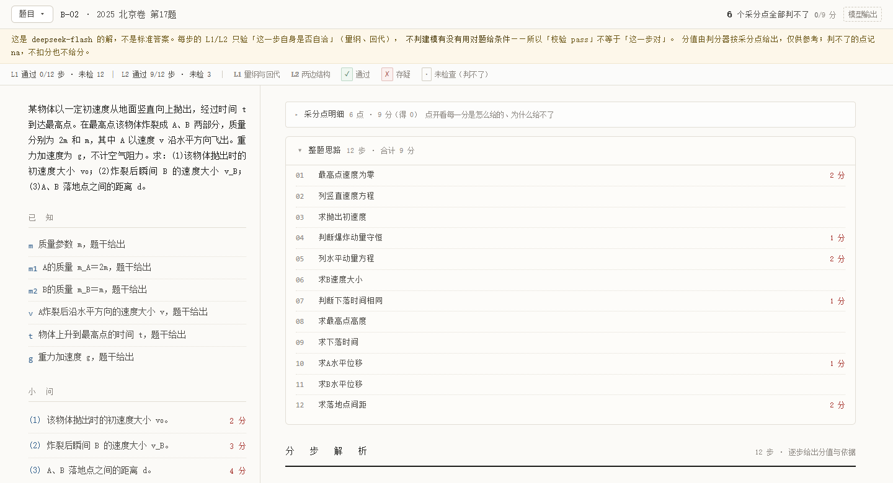

# 物理答疑 Agent · 分步解析 + 采分点判分

一个本地跑的高中物理大题解析工具。给一道题（题库内或题库外都行），输出**逐步解析页**：每步的方程、数值、依据，加上自洽检查（量纲、回代）与采分点命中情况。

没有云端服务，前端就是一张自包含的 HTML，产物落本地磁盘。



## 能做什么 / 不能做什么

**能**
- **题库内 20 道真题**（力学为主）：走完整链路 —— 解题 → Schema 校验 → L1/L2 验证器 → 采分点判分 → 解析页。判分用的采分点是人工拆的（223 步 / 344 分）。
- **题库外新题**：贴题干文字、或直接截图（Ctrl+V 粘贴 / 拖入 / 选文件），现场调模型解题，出解析页。**不判分** —— 新题没有人工采分点，模型自己写采分点再判自己等于自证。
- 只给图不给文字也行：模型会把题干与小问逐字转写回来，页面标注「题干由题图转写」。

**不能**
- 不判「建模有没有用对题给条件」，只判「这一步自身自洽不自洽、有没有命中采分点」。
- 新题的符号大多不在白名单内，L1/L2 会大面积 `na`。页面会明确写「符号未登记，这一层没检」，不会显示成「检过且通过」。
- 新题的卷面分若题面没印，是模型按推理量分配的，页面会标注「分值非题面所印」。

## 快速开始

```bash
pip install -r requirements.txt

# 演示模式：不调 API，复用已落盘的 20 题产物
python app.py --port 8765

# 实时模式：现场调模型（会花钱，约 0.1 元/题）
export DEEPSEEK_API_KEY=sk-...
python app.py --port 8765 --live
```

打开 http://127.0.0.1:8765 ，选一道题点「跑一遍」，或在下方「贴一道新题」里贴题。

## 目录结构

| 目录 | 内容 |
|---|---|
| `app.py` | 本地 HTTP 服务：任务队列、三段流水线、解析页拼装 |
| `schema/` | `answer.schema.json`（解析产物契约）与 `validate_schema.py`（结构 + 业务规则 R1–R13） |
| `验证器/` | L1 量纲、L2 代回、L3/L4 条件对照；`cli.py` 为入口 |
| `判分器/` | 采分点对齐与命中判定（`align.py` / `grader.py`） |
| `采分点/` | 20 题的人工采分点、拆解规范、双拆一致性实验 |
| `知识表/` | 公式库（sympy/pint 双向验过）、定律表、符号白名单 |
| `评测/T20/` | 题库外新题链路：`prompt_zero.md`（提示词）、`run_zero.py`（命令行）、`from_zero.py`（草稿 → Schema） |
| `原型/` | 解析页模板 `模型解析_20题.html` 与构建脚本 `_build_model.py`；`_selftest_*.py` 为验收脚本 |
| `原始资料/` | 真题原文、题图、整卷 PDF（仅研究用途，见下） |
| `历史备份/` | 迭代过程中的旧版本快照（`原名_备份_<时间或事件>.py`），只作追溯，不参与运行 |
| `过程文档/` | 选题定稿、闸门打勾稿、独立审核报告、用量审计；记录「当时为什么这么定」，不参与运行 |
| `STATE.md` | 活文档：做到哪一步、哪些结论还没独立验过；随进度更新 |
| `子agent/` | 各任务卡（T01–T36）的角色定义与交付要求，回看用 |

产物统一落 `临时/app/<job_id>/`：`{qid}.json`（产物）、`{qid}_validated.json`（校验后）、`{qid}_grade.json`（判分）、`result.html`（解析页）。

## 两条链路

```
题库内（demo/live）  题干+金标 → run_solve.solve → draft_to_schema.build → 验证器 → 判分器 → 解析页
题库外（zero）       题干/题图 → run_zero.solve_zero → from_zero.build_from_zero → 验证器 →（无判分）→ 解析页
```

差别只在「有没有金标」。题库内的字段转换大量 `deepcopy(gold)`；新题没有金标，题干、小问、物体表、目标量都改由模型输出提供。

## 验收

```bash
python 原型/_selftest_解析.py        # 解析页静态检查（101 项）
python 原型/_selftest_新题.py         # 新题页 + 接口拒绝分支
python schema/validate_schema.py 临时/app/<job>/{qid}.json
验证器/tests/ 下另有针对漏判的反例测试
```

## 已知边界

- 判分口径偏保守：只认「这一步自洽 + 命中采分点」，不认「答案对但过程跳步」。
- 部分公式框缺 `= 0`（排版问题，不影响判定）。
- 新题链路只实测过 4 道（含 1 道带图真题），样本小。
- 多物体、多过程真题的步骤切分仍可能偏离人工拆点。

## 数据说明

`原始资料/` 下的真题原文、题图与整卷 PDF 来自公开出版物与网络，**仅用于方法研究与效果评测**，版权归原出版方所有；如需商用请自行取得授权。

## 许可证

代码与自有文档（`app.py`、`schema/`、`验证器/`、`判分器/`、`知识表/`、`采分点/`、`评测/`、`原型/`、`历史备份/`）采用 **MIT**，全文见 [`LICENSE`](LICENSE)，可自由使用、修改、商用，保留版权声明即可。

例外：`原始资料/` 里的真题原文、题图、整卷 PDF 版权归原出版方，**不在 MIT 授权范围内**，随仓库提供只为让方法可复核。
